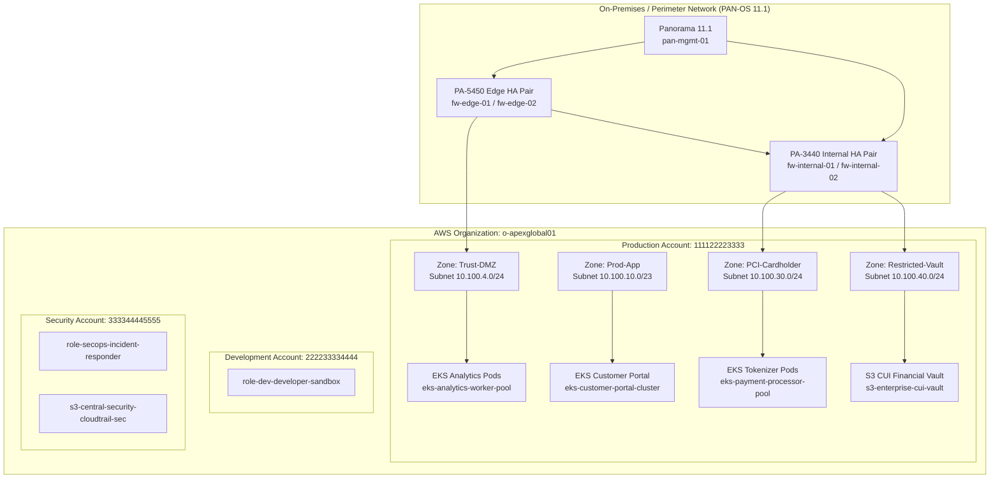
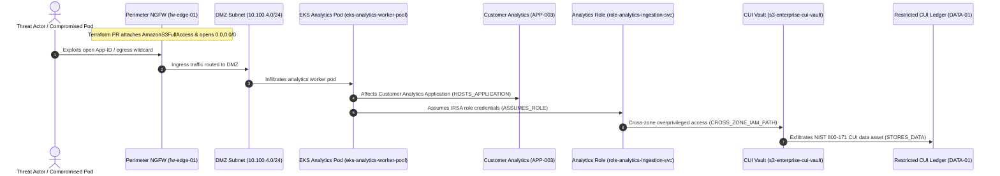
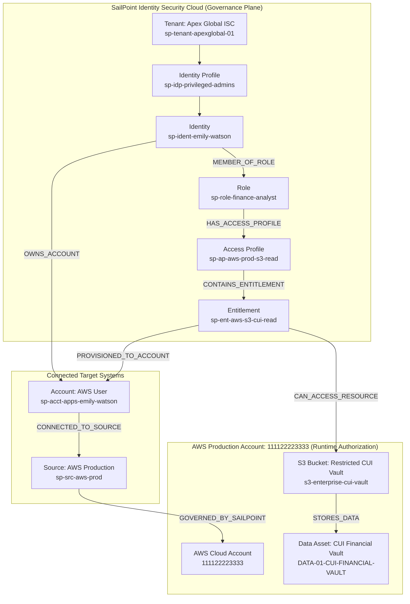

# Apex Global Technologies – Enterprise Demo Environment & Digital Twin Dataset

## 1. Executive Summary

This dataset represents **Apex Global Technologies** (`apex-global.example`), a fictional multinational financial technology enterprise operating an enterprise hybrid cloud architecture. 

The environment is designed as a high-fidelity synthetic benchmark for **SimuGuard AI** to model pre-deployment Terraform security changes, simulate lateral blast-radius propagation, and perform automated digital twin risk assessments.



---

## 2. Directory Structure & File Map

```text
demo_environment/
├── organisation.json                 # Apex Global Technologies enterprise metadata
├── README.md                         # Architecture reference and vulnerability catalog
├── network/
│   ├── firewalls.json                # PA-5450 Edge & PA-3440 Internal HA pairs
│   ├── panorama.json                 # Panorama 11.1 server, device groups, templates
│   ├── zones.json                    # 9 security zones (DMZ, Corp, PCI, Vault, etc.)
│   ├── interfaces.json               # Physical, Layer3, and Sub-interfaces
│   ├── subnets.json                  # 9 RFC 1918 enterprise subnets & VLANs
│   ├── routes.json                   # Virtual routers (vr-default-edge, vr-internal-core)
│   ├── address_objects.json          # 12 address objects & 3 address groups
│   ├── service_objects.json          # 10 service objects & 2 service groups
│   ├── security_policies.json        # 22 Palo Alto rules (Pre & Post rulebases)
│   └── nat_policies.json             # Inbound destination NAT & outbound PAT
├── cloud/
│   ├── aws_organisation.json         # AWS Org (o-apexglobal01) with 3 OUs
│   ├── accounts.json                 # Production, Development, and Security accounts
│   ├── vpcs.json                     # 3 VPCs (Prod 10.100/16, Dev 10.200/16, Sec 10.250/16)
│   ├── security_groups.json          # 7 AWS Security Groups (including unmapped)
│   ├── network_acls.json             # Default production and strict PCI NACLs
│   └── resources.json                # EKS clusters, ALBs, RDS databases, S3, KMS keys
├── iam/
│   ├── identities.json               # 16 IAM identities (roles, users, service principals)
│   ├── roles.json                    # 6 IAM roles with trust policies & boundaries
│   ├── policies.json                 # Customer-managed, AWS-managed & boundary policies
│   ├── trust_relationships.json      # EKS IRSA OIDC & cross-account trust configurations
│   └── resource_policies.json        # S3 bucket policies & KMS key policies
├── applications/
│   ├── applications.json             # 12 Tier-1/2/3 business applications
│   └── dependencies.json             # 8 cross-application API service call dependencies
├── data_assets/
│   ├── classifications.json          # 5 classification tiers (Restricted CUI to Public)
│   └── assets.json                   # 6 sensitive corporate data repositories
├── sailpoint/                         # SailPoint Identity Security Cloud Governance (Phase 3.7)
│   ├── tenant.json                   # Central IGA tenant (sp-tenant-apexglobal-01)
│   ├── sources.json                  # 8 connected target sources (AWS, AD, Entra, Panorama, DB)
│   ├── identity_profiles.json        # 4 authoritative lifecycle profiles (Employees, Contractors, Admins)
│   ├── identities.json               # 22 enterprise identities with risk classifications
│   ├── accounts.json                 # 50+ correlated accounts across target platforms
│   ├── entitlements.json             # 13 granular source permissions (S3 CUI, PanOS Superuser, etc.)
│   ├── access_profiles.json          # 11 source-scoped access profile bundles
│   ├── roles.json                    # 9 business and IT roles (Finance, SecOps, DevOps, NetSec)
│   ├── access_requests.json          # 5 access request workflow records (Approved, Rejected, Pending)
│   ├── approvals.json                # 5 multi-stage approval decision records
│   ├── certifications.json           # 5 access review and certification campaigns
│   ├── provisioning_events.json      # 5 automated provisioning events (Provisioned, Pending, Failed)
│   └── relationships.json            # 38 explicit governance and target access relationships
└── relationships/
    └── topology_edges.json           # 37 explicit digital twin topology edges
```

---

## 3. Network Architecture & Palo Alto Security Model

### 3.1 Firewall Deployment

Apex Global deploys next-generation firewalls running **PAN-OS 11.1 Nebula**:

| Device Hostname | Role | Platform | HA Mode | Enforced Zones | Device Group |
| :--- | :--- | :--- | :--- | :--- | :--- |
| `fw-edge-01-primary` | Internet Perimeter Primary | PA-5450 | Active/Passive | Untrust, DMZ, Corp, Transit | `DG-Internet-Perimeter` |
| `fw-edge-02-secondary` | Internet Perimeter Standby | PA-5450 | Active/Passive | Untrust, DMZ, Corp, Transit | `DG-Internet-Perimeter` |
| `fw-internal-01-primary`| Internal Segmentation Primary | PA-3440 | Active/Passive | Prod-App, Dev-App, DB, PCI, Vault | `DG-Internal-Segmentation` |
| `fw-internal-02-secondary`| Internal Segmentation Standby | PA-3440 | Active/Passive | Prod-App, Dev-App, DB, PCI, Vault | `DG-Internal-Segmentation` |
| `pan-mgmt-01` | Central Panorama Management | M-600 Virtual | Standalone | OOB-Mgmt | Shared Hierarchy |

### 3.2 Security Zone Taxonomy

1. **Untrust-Internet**: Ingress from public networks, terminated on `fw-edge-01-primary`.
2. **Trust-DMZ**: Public-facing reverse proxies, ingress ALBs, and analytics ingestion workers (`10.100.4.0/24`).
3. **Corp-Users**: Corporate campus workstations and VPN pools (`10.10.0.0/16`).
4. **Transit-Internal**: High-speed interconnect bridging perimeter and internal firewalls (`10.255.0.0/30`).
5. **Prod-App-Workloads**: Production containerized microservices and customer portal pods (`10.100.10.0/23`).
6. **Dev-App-Workloads**: Non-production developer sandbox pods (`10.200.10.0/23`).
7. **Database-Backend**: Core relational transactional databases (`10.100.20.0/24`).
8. **PCI-Cardholder-Data**: Strictly segregated PCI DSS tokenization enclave (`10.100.30.0/24`).
9. **Restricted-Data-Vault**: NIST SP 800-171 Controlled Unclassified Information storage (`10.100.40.0/24`).

---

## 4. Cloud Architecture & IAM Security Model

### 4.1 AWS Multi-Account Structure

- **Organization**: `o-apexglobal01`
  - **OU: Core** $\rightarrow$ Management Account
  - **OU: Workloads**
    - `111122223333` (**Apex-Production**): Production VPC (`10.100.0.0/16`), EKS clusters, RDS databases, S3 CUI financial vault.
    - `222233334444` (**Apex-Development**): Development VPC (`10.200.0.0/16`), dev sandbox, ephemeral telemetry.
  - **OU: Security**
    - `333344445555` (**Apex-Security**): Security VPC (`10.250.0.0/16`), central CloudTrail logging, GuardDuty, incident response tooling.

### 4.2 IAM Identity & Pod Federation (EKS IRSA)

Workload identities bind directly to AWS IAM roles via OpenID Connect (OIDC) federation, avoiding static long-lived credentials:
- `eks-analytics-worker-pool` $\xrightarrow{\text{IRSA}}$ `role-analytics-ingestion-svc`
- `eks-customer-portal-cluster` $\xrightarrow{\text{IRSA}}$ `role-customer-portal-backend`
- `eks-payment-processor-pool` $\xrightarrow{\text{IRSA}}$ `role-payment-processor-pci`

---

## 5. End-to-End Blast Radius Traversal & Attack Path

The dataset allows SimuGuard AI to trace complex, multi-hop attack paths spanning firewall policies, cloud network security, IAM roles, applications, and sensitive data assets.



---

## 6. Seeded Test Cases & Security Misconfiguration Catalog

The dataset deliberately includes real-world security vulnerabilities across layers to evaluate SimuGuard AI's detection and blast-radius engines:

### 6.1 Network & Firewall Misconfigurations

| ID | Resource | Type | Misconfiguration Description | Risk Level |
| :--- | :--- | :--- | :--- | :--- |
| `RULE-PAN-011` | `rule-emergency-any-any-bypass` | Security Policy | Inactive/forgotten emergency rule allowing `any` source, destination, and application with security profiles set to `none`. | **CRITICAL** |
| `RULE-PAN-014` | `rule-shadowed-portal-allow` | Security Policy | Exact duplicate of `RULE-PAN-001` positioned behind it in the rulebase, resulting in shadowed dead policy. | **MEDIUM** |
| `RULE-PAN-003` | `rule-allow-dmz-to-corp-services` | Security Policy | Security Profile Group is explicitly set to `none`, satisfying the `ZONE_INTERCONNECT_ROUTING` lateral movement condition. | **HIGH** |
| `RULE-PAN-006` | `rule-allow-prod-outbound-web` | Security Policy | Destination set to wildcard `any` and application set to `web-browsing`, allowing arbitrary egress tunneling. | **HIGH** |

### 6.2 AWS Cloud & IAM Misconfigurations

| ID | Resource | Type | Misconfiguration Description | Risk Level |
| :--- | :--- | :--- | :--- | :--- |
| `POLICY-IAM-002`| `AmazonS3FullAccess` | IAM Policy | Attaching AWS managed full access allows pods in DMZ to access `s3-enterprise-cui-vault` across zone boundaries. | **CRITICAL** |
| `POLICY-IAM-003`| `AdministratorAccess` | IAM Policy | Full wildcard `*` action across `*` resource; attached to `role-ci-cd-deployment-pipeline`. | **CRITICAL** |
| `TRUST-IAM-003` | `trust-excessive-dev-to-prod` | Cross-Account Trust | Insecure trust policy allowing development account (`222233334444`) to assume production deployment pipeline without MFA. | **CRITICAL** |
| `SG-CLOUD-007`  | `sg-guest-network-01` | Security Group | Completely unmapped security group in changes, requiring the engine to return `UNKNOWN` status. | **HIGH** |
| `S3-BUCKET-003` | `s3-dev-staging-telemetry` | S3 Storage | Public Access Block is disabled and bucket policy allows unauthenticated s3:GetObject. | **HIGH** |

---

## 7. Digital Twin Graph Ingestion

The dataset is ingested by `EnterpriseDatasetLoader` and compiled into a unified NetworkX directed graph:

```python
from simuguard.graph.dataset_loader import EnterpriseDatasetLoader
from simuguard.graph.blast_radius import BlastRadiusAnalyzer

# Ingest and validate dataset
loader = EnterpriseDatasetLoader()
report = loader.validate_dataset()
assert report.is_valid is True

# Load into Digital Twin
dt = loader.load_as_digital_twin_graph()
print(f"Nodes: {dt.node_count}, Edges: {dt.edge_count}")

# Execute blast radius traversal
analyzer = BlastRadiusAnalyzer(dt)
# Traverses: Firewall -> Zone -> Subnet -> Workload -> Application -> IAM Role -> S3 -> Data Asset
```

---

## 8. SailPoint Identity Security Cloud (ISC) Governance Architecture (Phase 3.7)

### 8.1 Architectural Paradigm & Identity Governance Model

In Phase 3.7, **Apex Global Technologies** established **SailPoint Identity Security Cloud (ISC)** as the authoritative enterprise Identity Governance and Administration (IGA) platform (`apexglobal.identitynow.example`). 

#### Core Architectural Distinction: Governance vs. Authorization
- **SailPoint ISC (Governance Plane)**: Answers **who should have access**, **why they have it**, **who approved it**, and **when it was certified**. It governs business roles, access profiles, lifecycle state (Joiner, Mover, Leaver), separation-of-duties (SoD) policies, and multi-stage compliance approvals.
- **AWS IAM & PAN-OS (Runtime Authorization Enforcement Plane)**: Answers **what a specific authenticated principal or packet is allowed to do at runtime**. AWS IAM enforces SCPs, permission boundaries, and resource policies; Palo Alto PAN-OS enforces Layer 7 App-ID, Threat Prevention, and security zones.
- **Governed Connected Sources**: SailPoint connects to AWS accounts (`111122223333`, `222233334444`, `333344445555`), Panorama management (`pan-mgmt-01`), Active Directory, Entra ID, and transactional databases via `GOVERNED_BY_SAILPOINT` edges. SailPoint governance does **not** delete or replace underlying AWS resource permissions or IAM trust policies.



### 8.2 Identity vs. Account Entity Model

A foundational principle of SailPoint governance is the strict separation between an **Identity** and its **Accounts**:
- **Identity (`SailPoint_Identity`)**: Represents a single physical human (employee, contractor) or service principal. Attributes include `lifecycle_state`, `employment_type`, `department`, `manager_id`, and `risk_classification`.
- **Account (`SailPoint_Account`)**: Represents a target-specific credential or user object existing inside a connected system (e.g., Active Directory `s.chen`, Entra ID `sarah.chen@apex-global.example`, AWS IAM `sarah.chen-exec`, Panorama `pan_admin_david`).
- **One-to-Many Correlation**: An identity owns multiple source accounts via explicit `OWNS_ACCOUNT` relationships.

### 8.3 Role-Based Access Control (RBAC) Hierarchy

SailPoint structures access rights in a three-tier governance hierarchy:
1. **Roles (`SailPoint_Role`)**: Business or IT roles (e.g., `Finance & Treasury Analyst`, `Network Security Engineer`, `Cloud Platform Administrator`).
2. **Access Profiles (`SailPoint_AccessProfile`)**: Source-specific bundles of entitlements (e.g., `Production S3 CUI Vault Read Access`, `Palo Alto Firewall Administrator Access`).
3. **Entitlements (`SailPoint_Entitlement`)**: Granular, source-native access rights (e.g., AWS action `s3:GetObject` on `arn:aws:s3:::corp-restricted-cui-financial-vault/*`, Panorama `Superuser` write privilege).

### 8.4 Lifecycle, Approvals, and Provisioning Gate Rules

SimuGuard AI enforces strict governance evaluation rules during blast-radius analysis:
- **`PENDING_IS_NOT_ACCESS`**: In-flight access requests with status `PENDING_APPROVAL` (e.g., `sp-req-1003-pending-admin-access`) have **not** been approved and convey **zero** effective permissions. The traversal engine never treats pending requests as granted access.
- **`PROVISIONING_GATE`**: Request approval is a governance mandate, but access is only operationally realized when downstream provisioning transitions to `PROVISIONED` with verified source reconciliation (`VERIFIED_ON_SOURCE`). Events in `REQUESTED_NOT_PROVISIONED` or `FAILED` states do not grant runtime access.
- **`CERTIFICATION_REVOCATION_RECONCILIATION`**: A certification campaign decision to revoke access (e.g., `sp-cert-2025-q4-dormant-revoked`) is a governance decision; target access persists until automated deprovisioning events remove the entitlement on the target source.

### 8.5 End-to-End Governance Traversal Paths

The Digital Twin graph connects the complete identity-to-data chain:
- **Financial Analyst $\rightarrow$ CUI Data Asset**:
  `sp-ident-emily-watson` $\xrightarrow{\text{MEMBER_OF_ROLE}}$ `sp-role-finance-analyst` $\xrightarrow{\text{HAS_ACCESS_PROFILE}}$ `sp-ap-aws-prod-s3-read` $\xrightarrow{\text{CONTAINS_ENTITLEMENT}}$ `sp-ent-aws-s3-cui-read` $\xrightarrow{\text{CAN_ACCESS_RESOURCE}}$ `s3-enterprise-cui-vault` $\xrightarrow{\text{STORES_DATA}}$ `DATA-01-CUI-FINANCIAL-VAULT`
- **Network Security Engineer $\rightarrow$ Panorama Management**:
  `sp-ident-david-kim` $\xrightarrow{\text{MEMBER_OF_ROLE}}$ `sp-role-network-security-engineer` $\xrightarrow{\text{HAS_ACCESS_PROFILE}}$ `sp-ap-paloalto-firewall-admin` $\xrightarrow{\text{CONTAINS_ENTITLEMENT}}$ `sp-ent-panos-admin-write` $\xrightarrow{\text{CAN_ACCESS_RESOURCE}}$ `pan-mgmt-01`

