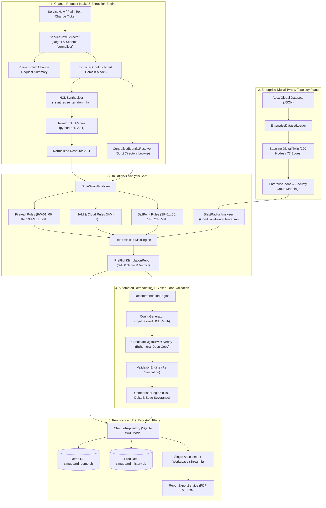
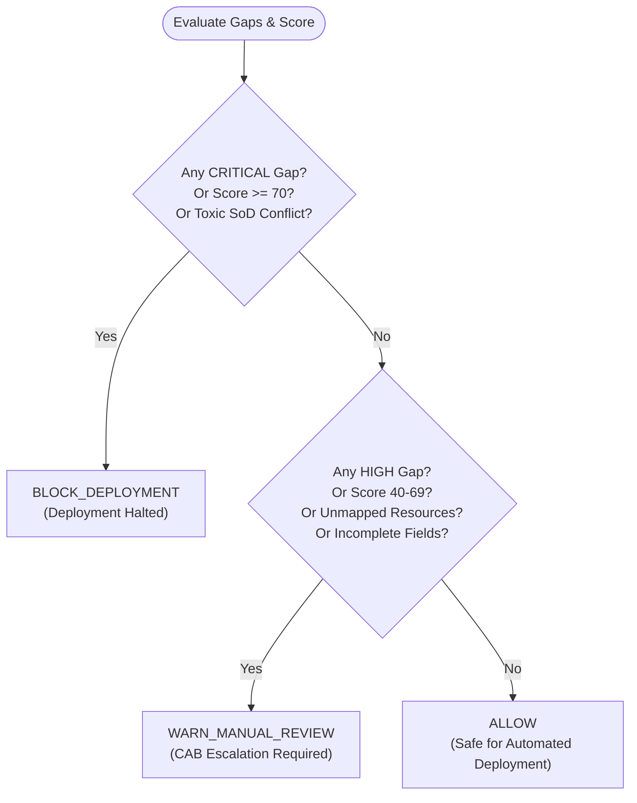
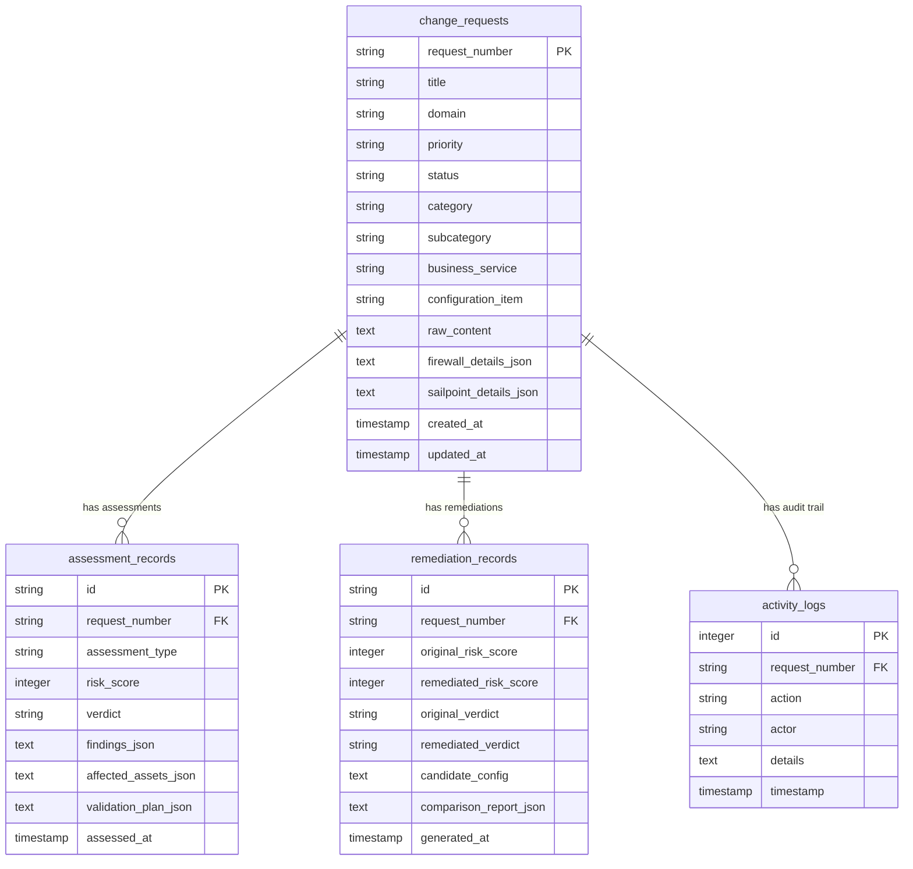
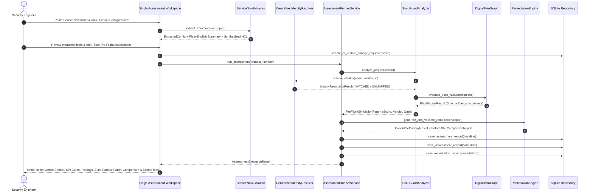

# SimuGuard AI — System Architecture & Component Design
**Apex Global Technologies Enterprise Pre-Flight Security Platform**

---

## 1. High-Level Architectural Overview

SimuGuard AI is an air-gapped, pre-deployment change-risk simulation and automated remediation platform. It evaluates proposed enterprise network infrastructure changes (Palo Alto PAN-OS firewall policies, AWS security groups) and cloud identity access modifications (SailPoint Identity Security Cloud, AWS IAM) against a comprehensive enterprise **Digital Twin** topology before deployment to production.

The platform is designed around a unified **Single Assessment Workspace** that consolidates the entire risk assessment lifecycle into a single operational view: ticket ingestion, configuration extraction, business summary generation, deterministic simulation, blast radius analysis, automated candidate patch synthesis, before-and-after comparison, and executive compliance report export.

---

## 2. Application Components and Responsibilities

| Subsystem | Primary Python Modules | Responsibilities |
| :--- | :--- | :--- |
| **User Interface** | `ui/pages/workspace.py` `ui/theme.py` `ui/layout.py` | Unified single-page engineer workspace, dark-navy ticket intake area (300px), plain-English summary display, interactive assessment execution, inline findings, blast radius inspection, candidate remediation review, and export tabs. |
| **ServiceNow Intake & Extraction** | `ui/services/servicenow_extractor.py` | Ingests raw ServiceNow ticket text, extracts headers, priority, firewall rules, NAT rules, IAM attributes, approvals matrices, employee/worker details (`EMP-...`, `CTR-...`), generates plain-English change summaries, and synthesizes Terraform HCL on-the-fly. |
| **Terraform & HCL Parsing** | `simuguard/parsers/hcl_parser.py` `simuguard/parsers/resource_models.py` | Wraps `python-hcl2` to convert synthesized or uploaded HCL into strictly-typed Pydantic AST models (`panos_security_policy`, `aws_security_group_rule`, `aws_iam_role_policy_attachment`, `aws_iam_policy`). Catches syntax and provider errors gracefully. |
| **Centralized Identity Resolver** | `simuguard/identity/resolver.py` | Correlates requested workers and target accounts against authoritative SailPoint identity stores. Strictly prohibits unauthorized identity substitution when explicit employee/worker IDs are unmapped. Detects name conflicts and duplicate/ambiguous matches. |
| **Enterprise Digital Twin** | `simuguard/graph/dataset_loader.py` `simuguard/graph/digital_twin.py` | Compiles 220 active enterprise nodes (firewalls, zones, subnets, compute, data vaults, identities, accounts, entitlements) and 77 directional topology relationships into a NetworkX directed graph (`nx.DiGraph`). Enforces explicit security group and zone alias mappings. |
| **Condition-Aware Blast Radius** | `simuguard/graph/blast_radius.py` | Analyzes topological attack propagation by conditionally evaluating edge constraints (`ENFORCES_ZONE_POLICY`, `ZONE_INTERCONNECT_ROUTING`, `CROSS_ZONE_IAM_PATH`). Categorizes impacted assets into `DIRECT` entrypoints and `CASCADING` transitive dependencies. Flags unmapped resources as `ImpactStatus.UNKNOWN`. |
| **Deterministic Security Rules** | `simuguard/rules/` `simuguard/engine/analyzer.py` | Evaluates deterministic compliance policies across network security (`FW-01`..`FW-06`, `INCOMPLETE-01`), cloud IAM (`IAM-01`), and SailPoint governance (`SP-01`..`SP-06`, `SP-CORR-01`, `SOD-01`..`SOD-03`). |
| **Quantitative Risk Engine** | `simuguard/engine/risk_engine.py` | Computes a bounded composite risk score ($0 - 100$) by combining gap severities, maximum traversed asset criticalities, and blast radius multipliers. Enforces unambiguous hierarchical verdict precedence (`BLOCK_DEPLOYMENT`, `WARN_MANUAL_REVIEW`, `ALLOW`). |
| **Automated Remediation Engine** | `simuguard/remediation/` | Generates actionable remediation plans (`RecommendationEngine`), synthesizes least-privilege candidate HCL (`ConfigGenerator`), provisions an ephemeral graph copy (`CandidateDigitalTwinOverlay`), and validates risk reduction (`ValidationEngine`, `ComparisonEngine`). |
| **Storage & Persistence** | `storage/database.py` `storage/repository.py` | Thread-safe SQLite persistence with WAL journaling, foreign keys, and atomic transactions. Enforces strict separation between demo sandbox (`simuguard_demo.db`) and production history (`simuguard_history.db`). |
| **Audit Reporting Pipeline** | `ui/services/report_export_service.py` | Generates two-pass numbered Executive PDF audit reports (ReportLab Platypus) and machine-readable JSON compliance artifacts. |

---

## 3. Change Request Ingestion & Extraction Workflow

The ingestion pipeline converts unstructured enterprise change tickets into typed, verifiable simulation inputs:

1. **Text Intake**:
   - The engineer pastes a complete ServiceNow change ticket into the 300px dark-navy text area or clicks one of the certified sample scenarios (`CHG-1001` through `CHG-1005`, `PR-4082`, `PR-4083`, `Netflix`, `Safe Rule`, `SailPoint`).
2. **Regex Parsing & Pattern Matching**:
   - Matches standard change headers (`CHANGE REQUEST:`, `REQUEST:`, `CHG...`, `RITM...`).
   - Normalizes priority strings (e.g. `3 - Moderate` $\rightarrow$ `MEDIUM`, `4 - Low` $\rightarrow$ `LOW`).
   - Disambiguates catalog service names (`Service: Network Security - Palo Alto`) from transport protocol services (`Service: tcp/443`, `tcp/5432`).
   - Parses multi-role approvals blocks (`Line Manager: Approved`, `CAB: Pending`) and tracks overall approval status (`APPROVED`, `PENDING`, `REJECTED`).
   - For IAM requests, parses worker names, employee IDs (`EMP-4102`), contractor IDs (`CTR-0924`), worker type, and bulleted additions/removals (`ADD:`, `REMOVE:`).
3. **Plain-English Change Request Summary**:
   - Automatically synthesized and displayed before the extracted field review:
     - **1. What is being requested?**: Simple plain-English description of the technical action.
     - **2. Why is this change requested?**: Exact business justification extracted from the original ticket without unauthorized fabrication.
     - **3. Key configuration changes**: Structured native Streamlit table displaying operation, target, zones, addresses, applications, services, and profile parameters.
     - **4. Initial observations & potential risks**: Pre-flight highlights of detected wildcards, missing security profiles, disabled logging, or pending approvals.
4. **Terraform HCL Synthesis**:
   - `_synthesize_terraform_hcl` converts extracted firewall rules into standardized `panos_security_policy` Terraform code, enabling direct execution through the HCL parsing and rule evaluation pipelines.
5. **In-Place Field Review & Editable Form**:
   - Extracted values populate an editable review form where the engineer can inspect, adjust, or correct fields prior to simulation.

---

## 4. Firewall and IAM Analysis Pipelines

### A. Network Security Pipeline (PAN-OS & AWS Security Groups)
1. **HCL AST Parsing**: Synthesized or uploaded Terraform HCL is parsed into typed resource models (`NormalizedPanosSecurityPolicy`, `NormalizedAwsSecurityGroupRule`).
2. **Rule Analysis**:
   - `FW-01`: Flags wildcard App-ID deep inspection bypass (`applications = ["any"]`).
   - `FW-02`: Flags unrestricted outbound egress (`destination_addresses = ["any"]` or `0.0.0.0/0`).
   - `FW-03`: Flags missing Threat Prevention profile groups (`security_profile_group = "none"`).
   - `FW-04`: Flags insecure cleartext protocols (HTTP, Telnet) or exposed database listener ports.
   - `FW-05`: Checks rule ordering and shadowing across existing policies.
   - `FW-06`: Detects direct cross-zone crossings between untrusted/DMZ zones and restricted data zones.
   - `INCOMPLETE-01`: Flags placeholder addresses (`TBD`, `to confirm`) and unassigned network parameters.
3. **Topological Blast Radius Traversal**:
   - Evaluates perimeter firewall routing, source zone, and destination zone against Digital Twin nodes.
   - If destination or source zones are unmapped (e.g. `DC-APP`, `VPN-VENDOR`), records unmapped resources and flags unknown impact.

### B. Identity Governance Pipeline (SailPoint ISC & AWS IAM)
1. **Centralized Identity Resolution**:
   - Resolves target worker via `CentralizedIdentityResolver`.
   - If an explicit employee/worker ID is provided and absent from the directory, returns `UNMAPPED` and **strictly prohibits** falling back to name/substring guessing.
2. **Governance Rule Analysis**:
   - `SP-01`: In-flight access assumption (enforces `PENDING_IS_NOT_ACCESS` when ticket approvals are incomplete).
   - `SP-02`: Unprovisioned birthright access (enforcing access prior to account provisioning).
   - `SP-03`: Toxic Separation of Duties conflicts evaluated against the enterprise SoD matrix (`SOD-01`..`SOD-03`).
   - `SP-04`: External contractor privileged access violations.
   - `SP-05`: Dormant revoked entitlements.
   - `SP-06`: Privilege creep (entitlement count exceeding departmental baselines).
   - `SP-CORR-01`: Unmapped identity in authoritative directory.
3. **Cloud IAM Rule Analysis**:
   - `IAM-01`: Cloud privilege escalation (broad managed policies like `AdministratorAccess` or `AmazonS3FullAccess` attached to compute workload roles).

---

## 5. Digital Twin Architecture & Relationships

The enterprise Digital Twin is compiled by `EnterpriseDatasetLoader` from static JSON files in `demo_environment/` into an in-memory `networkx.DiGraph`:

- **220 Total Enterprise Nodes**:
  - `Firewall`: Physical and virtual next-generation firewalls (`fw-edge-01-primary`, `fw-internal-01-primary`).
  - `Layer3_Security_Zone`: Enterprise network zones (`Untrust-Internet`, `Trust-DMZ`, `Prod-App-Workloads`, `Database-Backend`, `PCI-Cardholder-Data`, `Restricted-Data-Vault`, `Corp-Users`).
  - `Subnet`: Network CIDRs with VLAN and routing attributes.
  - `Compute`: EKS worker pools, Kubernetes pods, and EC2 instances.
  - `DataAsset`: Structured financial vaults, customer databases, and S3 object stores.
  - `Identity`, `Account`, `Role`, `Entitlement`: SailPoint ISC identity governance nodes.
- **77 Directional Topology Relationships**:
  - `ENFORCES_ZONE_POLICY`: Perimeter firewall enforcing traffic between zones.
  - `ZONE_INTERCONNECT_ROUTING`: Core firewall routing traffic between internal subnets.
  - `CONTAINS_WORKLOAD`: Subnet hosting compute nodes.
  - `APPLIES_SECURITY_GROUP`: AWS security group bound to compute workloads.
  - `ASSUMES_ROLE`: Workload instance profile assuming an IAM role.
  - `ATTACHED_POLICY`: IAM role granting access to S3 vaults or RDS instances.
  - `IDENT_ASSIGNED_ROLE`, `ACCOUNT_HAS_ENTITLEMENT`: SailPoint identity governance bindings.
- **Enterprise Zone & Security Group Aliases**:
  - Canonical aliases map ticket terminology (`Trust-Application` $\rightarrow$ `zone-prod-app-workloads`, `Trust-Database` $\rightarrow$ `zone-database-backend`) while keeping genuinely external or unknown zones (`DC-APP`, `VPN-VENDOR`) explicitly unmapped.

---

## 6. Risk Calculation & Decision Logic

SimuGuard AI calculates risk using a deterministic three-stage mathematical model:

### Stage 1: Base Severity Score
$$\text{Base Score} = \sum_{g \in \text{DeduplicatedGaps}} W(\text{severity}_g) \times M(\text{highest\_criticality})$$

- **Severity Weights $W(\text{severity})$**:
  - $\text{CRITICAL} = 40.0$
  - $\text{HIGH} = 25.0$
  - $\text{MEDIUM} = 10.0$
  - $\text{LOW} = 3.0$
- **Asset Criticality Multipliers $M(\text{criticality})$**:
  - $\text{CRITICAL} = 1.5$ (e.g. `s3-enterprise-cui-vault`, `Database-Backend`)
  - $\text{HIGH} = 1.2$ (e.g. `fw-edge-01-primary`, `zone-trust-dmz`)
  - $\text{MEDIUM} = 1.0$ (Default enterprise assets)
  - $\text{LOW} = 0.8$ (Development/staging assets)

### Stage 2: Blast Radius Multiplier ($\beta$)
$$\beta = \min\left(2.0, \; \max\left(1.0, \; 1.0 + 0.05 \times N_{\text{direct}} + 0.02 \times N_{\text{cascading}}\right)\right)$$

### Stage 3: Bounded Composite Score & Verdict Precedence
$$\text{Score} = \min\left(100, \; \max\left(0, \; \text{round}\left(\text{Base Score} \times \beta\right)\right)\right)$$

---

## 7. Candidate Remediation & Closed-Loop Validation

Rather than simply rejecting non-compliant requests, SimuGuard AI automatically synthesizes a safe candidate configuration:

1. **Recommendation Generation** (`RecommendationEngine`):
   - Scopes wildcard destinations (`0.0.0.0/0` $\rightarrow$ verified partner CIDR).
   - Enforces explicit App-IDs (`applications = ["ssl", "web-browsing"]`).
   - Attaches enterprise Threat Prevention security profile groups.
   - Enables session-end traffic logging.
   - Detaches overprivileged IAM policies (`AmazonS3FullAccess`) and generates scoped least-privilege policies.
2. **Candidate HCL Synthesis** (`ConfigGenerator`):
   - Generates clean, ready-to-deploy Terraform HCL incorporating all recommendations.
3. **Ephemeral Overlay Simulation** (`CandidateDigitalTwinOverlay`):
   - Creates an in-memory deep copy of the Digital Twin graph.
   - Applies candidate additions and severs non-compliant edges (e.g. removing the data exfiltration path to the CUI Vault).
4. **Re-Assessment & Differential Comparison** (`ValidationEngine`, `ComparisonEngine`):
   - Re-runs the complete simulation on the candidate configuration over the overlay graph.
   - Computes the risk score delta (e.g. $100 \rightarrow 0$ points), confirms resolved findings, and validates that original scenario files remain 100% untouched.

---

## 8. Database Architecture and Data Flow

SimuGuard AI uses SQLite with WAL mode, foreign key enforcement, and atomic transactions.

- **Physical Separation**:
  - `data/simuguard_demo.db`: Dedicated demonstration sandbox containing pre-loaded scenarios.
  - `data/simuguard_history.db`: Isolated production history database. Stays strictly at **0 records** during demo operations.

---

## 9. Application Execution Flow

---

## 10. Reporting and Export Pipeline

- **Executive Audit PDF**:
  - Built by `ReportExportService` using ReportLab Platypus.
  - Employs a custom two-pass canvas (`ReportNumberedCanvas`) to render dynamic headers and "Page X of Y" footers.
  - Formats executive decision banners, risk score KPIs, gap details with CIS/NIST compliance mappings, blast radius asset inventories, and differential comparison tables.
- **Machine-Readable JSON Artifact**:
  - Exports a structured, schema-versioned (`1.0.0`) JSON document containing the complete evaluation payload, raw findings, validation checks, and synthesized candidate diffs.
- **Sanitized Export Naming**:
  - `get_safe_export_filename()` cleanses ticket identifiers, ensuring cross-platform filesystem safety.
