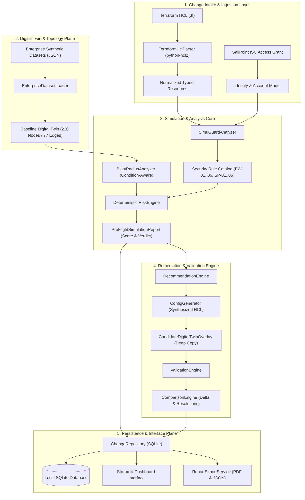
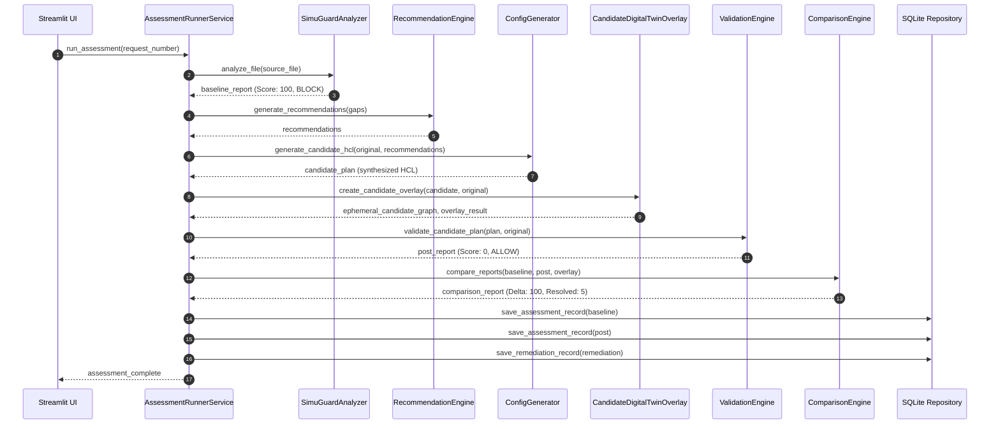

# SimuGuard AI — System Architecture & Component Design
**Apex Global Technologies Enterprise Pre-Flight Security Platform**

---

## 1. High-Level Architectural Overview

SimuGuard AI is built upon an air-gapped, modular pipeline design. Proposed infrastructure changes (Terraform HCL) and access requests (SailPoint ISC) flow through a series of decoupled engines that ingest, model, analyze, score, remediate, and validate changes before deployment.

---

## 2. Core Subsystems & Components

### A. Data Ingestion & Terraform Parsing Engine
- **Module**: `simuguard/parsers/hcl_parser.py` & `resource_models.py`
- **Core Technology**: `python-hcl2` wrapped by strict Pydantic normalization models.
- **Responsibilities**:
  - Ingests `.tf` files and extracts top-level blocks: `panos_security_policy`, `aws_security_group_rule`, `aws_iam_role_policy_attachment`, and `aws_iam_policy`.
  - Normalizes attribute representations (e.g. converting single strings to lists, standardizing port ranges, resolving protocol encodings).
  - Isolates HCL syntax errors (`SYNTAX-01`) and provider schema errors (`SCHEMA-01`) without throwing uncaught runtime exceptions.

### B. Enterprise Digital Twin & Blast Radius Engine
- **Module**: `simuguard/graph/dataset_loader.py`, `digital_twin.py`, & `blast_radius.py`
- **Core Technology**: NetworkX directed multi-relational graph (`nx.DiGraph`).
- **Graph Topology**:
  - **220 active enterprise nodes** categorized into 7 operational domains: Firewalls (PAN-OS), Network Zones, Subnets, Compute Clusters (EKS/EC2), IAM Roles, Storage/Data Assets (S3 Vaults, RDS, KMS), and SailPoint Governance Entities (Identities, Accounts, Roles, Entitlements).
  - **77 directional relationships** modeling physical topology, network routing, IAM attachments, data storage containment, and governance bindings.
- **Condition-Aware Blast Radius Traversal**:
  - Does not blindly expand all edges; evaluates edge conditions:
    - `ENFORCES_ZONE_POLICY`: Traverses to compute workloads only if App-ID is bypassed (`any`) or destination is unsegmented (`any`).
    - `ZONE_INTERCONNECT_ROUTING`: Traverses to restricted data zones only if security profile groups are omitted or disabled (`none`).
    - `CROSS_ZONE_IAM_PATH`: Traverses to `s3-enterprise-cui-vault` only if overprivileged wildcard policies (`AmazonS3FullAccess` or `AdministratorAccess`) are present.
  - Correctly categorizes assets into `DIRECT` impacts vs `CASCADING` transitive impacts.
  - Implements `ImpactStatus.UNKNOWN` fallback when encountering unmapped security groups or identities.

### C. Deterministic Security Rules & Risk Engine
- **Module**: `simuguard/rules/` & `simuguard/engine/risk_engine.py`
- **Security Rules**:
  - **Firewall Rules (`FW-01` to `FW-06`)**: App-ID bypass, unrestricted egress, missing threat profiles, cleartext protocols, rule shadowing, cross-zone segmentation violations.
  - **SailPoint Rules (`SP-01` to `SP-06`)**: In-flight access assumption (`PENDING_IS_NOT_ACCESS`), unprovisioned access grants, toxic Separation of Duties pairs (`SOD-01` to `SOD-03`), contractor privileged access, dormant revoked entitlements, privilege creep.
- **Deterministic Mathematical Scoring**:
  $$\text{Base Score} = \sum_{g \in \text{DeduplicatedGaps}} W(\text{severity}_g) \times M(\text{highest\_criticality})$$
  $$\beta = \min\left(2.0, \; 1.0 + 0.05 \times N_{\text{direct}} + 0.02 \times N_{\text{cascading}}\right)$$
  $$\text{Composite Risk Score} = \min\left(100, \; \max\left(0, \; \text{round}\left(\text{Base Score} \times \beta\right)\right)\right)$$
- **Verdict Precedence Rules**:
  - **`BLOCK_DEPLOYMENT`**: Any CRITICAL gap, prohibited SoD, or score $\ge 70$.
  - **`WARN_MANUAL_REVIEW`**: Any HIGH gap, score $40 - 69$, or unresolved UNKNOWN impact.
  - **`ALLOW`**: Score $< 40$, zero CRITICAL findings, zero HIGH findings, and zero UNKNOWN impacts.

### D. Automated Remediation & Closed-Loop Validation Engine
- **Module**: `simuguard/remediation/`
- **Components**:
  - `RecommendationEngine`: Converts identified gaps into actionable technical remedies.
  - `ConfigGenerator`: Synthesizes clean candidate Terraform HCL without modifying original scenario files.
  - `CandidateDigitalTwinOverlay`: Clones the Digital Twin graph and applies candidate additions/removals (e.g. severing overprivileged IAM edges).
  - `ValidationEngine`: Re-runs the complete simulation on the candidate configuration over the overlay graph.
  - `ComparisonEngine`: Generates a differential validation report computing risk delta, resolution status (`RESOLVED`, `PARTIALLY_RESOLVED`, `MANUAL_REVIEW`), and verified severed edges.

---

## 3. Storage & Persistence Architecture

- **Engine**: SQLite 3 with strict foreign keys (`PRAGMA foreign_keys = ON;`) and WAL journaling.
- **Database Partitioning**:
  - `data/simuguard_history.db`: Clean production database for enterprise records.
  - `data/simuguard_demo.db`: Isolated demonstration database containing the 5 certified scenarios.
- **Concurrency & Atomic Transactions**:
  - Sequential request number allocation (`SIM-CHG-XXXX` or `SIM-DEMO-XXXX`) with monotonic numeric extraction.
  - Up to 5 collision retry attempts on `sqlite3.IntegrityError`.
  - Atomically commits change request records and initial activity logs within a single transaction.
- **Upload Staging & Sanitization**:
  - `storage/upload_handler.py` enforces a 5MB size limit, rejects binary content (`\x00`), and sanitizes filenames against path traversal, null bytes, Windows ADS separators, and Unicode directional overrides.
  - `cleanup_orphaned_uploads()` scans older files and ensures active evidence is never deleted.

---

## 4. Reporting Pipeline Architecture

- **Executive PDF Reporting**:
  - Implemented in `ui/services/report_export_service.py` via `reportlab.platypus`.
  - Uses two-pass canvas numbering (`ReportNumberedCanvas`) for running page headers and footers ("Page X of Y").
  - Dynamically builds executive summaries, gate verdicts, gap tables with compliance mappings, blast radius asset inventories, and differential comparison sections.
- **Structured JSON Reporting**:
  - Generates machine-readable, schema-versioned (`1.0.0`) audit artifacts containing all assessment metrics, raw findings, and candidate diffs.
- **Path Sanitization**:
  - `get_safe_export_filename()` strips all invalid characters, enforcing clean alphanumeric file naming.
