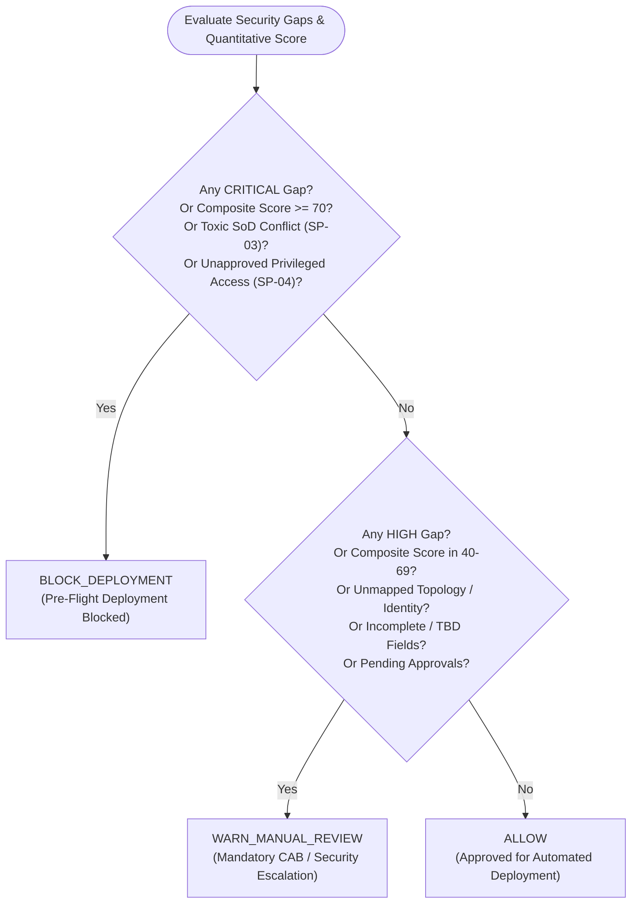

# SimuGuard AI — Security Model & Mathematical Risk Methodology
**Apex Global Technologies Enterprise Cybersecurity Architecture**

---

## 1. Core Security Philosophy & Invariants

SimuGuard AI operates under strict security and architectural invariants designed to guarantee zero production risk:

1. **Air-Gapped Simulation Architecture**: The platform performs all pre-flight simulations locally without requiring outbound network connectivity, production credentials, or live API keys. All evaluations execute against an internal synthetic Digital Twin model.
2. **Zero Direct Production Configuration Changes**: The platform cannot commit, push, or apply changes directly to live firewalls (Palo Alto Panorama), identity governance platforms (SailPoint ISC), or cloud providers (AWS). It is strictly a pre-deployment simulation and advisory engine.
3. **Candidate Overlay Approach & Baseline Immutability**: Automated remediation patches are evaluated on an ephemeral deep copy of the Digital Twin (`CandidateDigitalTwinOverlay`). The baseline topology, original scenario files, and enterprise datasets remain 100% immutable throughout the assessment lifecycle.
4. **Deterministic Risk Decision Engine**: Identical input configurations evaluated against identical Digital Twin topologies produce identical risk scores, gap findings, and deployment verdicts. No stochastic, probabilistic, or generative LLM scoring mechanisms are employed.
5. **Verdict Precedence Over Numerical Scores**: Severe security violations (CRITICAL findings, toxic Separation of Duties, in-flight unapproved access, or unresolved unmapped dependencies) unconditionally override numerical thresholds. A low numerical score can never force an `ALLOW` verdict if a critical vulnerability exists.
6. **Unknown Is Never Assumed Safe**: Unmapped resources, missing CIDR classifications, unverified network zones, or unmapped identities are categorized as `ImpactStatus.UNKNOWN`, triggering mandatory manual review (`WARN_MANUAL_REVIEW`) or blocking deployment. Missing topology data is never treated as proof of isolation.
7. **Strict Identity Resolution & Zero Substitution**: When an explicit employee or contractor ID is provided in a ticket, the resolver must find an exact match in the authoritative directory. If the ID is unmapped, fuzzy or substring fallback to another identity is strictly prohibited.

---

## 2. Security Rule Catalog

### A. Network Security Rules (`FW-01` to `FW-06`, `INCOMPLETE-01`)

| Rule ID | Severity | Policy Title | Compliance Benchmark | Technical Impact Evaluated |
| :--- | :---: | :--- | :--- | :--- |
| **`FW-01`** | **CRITICAL** | PAN-OS App-ID Deep Inspection Bypass | CIS Palo Alto Firewall v1.1.0 (4.1) NIST CSF 2.0 PR.PT-04 | Setting `applications = ["any"]` on `allow` rules disables Palo Alto Layer 7 App-ID deep packet classification, permitting arbitrary protocol tunneling and C2 communications. |
| **`FW-02`** | **HIGH / CRITICAL** | Unrestricted Outbound Egress | CIS Palo Alto Benchmark (4.3) NIST SP 800-171 3.13.6 | Permitting egress to `0.0.0.0/0` or `destination_addresses = ["any"]` without partner CIDR scoping. AWS SG rules with `protocol = "-1"` escalate to CRITICAL. |
| **`FW-03`** | **HIGH** | Missing Threat Prevention Profile Group | CIS Palo Alto Benchmark (4.2) NIST SP 800-171 3.13.1 | Rules traversing protected zones (`Trust-DMZ`, `Internal-Core`, `Restricted-Data-Vault`, `PCI-Cardholder-Zone`) that omit or set `security_profile_group = "none"`. |
| **`FW-04`** | **MEDIUM / CRITICAL** | Insecure Cleartext Protocol / DB Exposure | NIST SP 800-52 Rev 2 PCI-DSS Req 4.1 | Permitting cleartext protocols (HTTP, Telnet) across network boundaries. Exposure of direct database ports (3306, 5432) to `0.0.0.0/0` escalates to CRITICAL. |
| **`FW-05`** | **MEDIUM** | Security Rule Shadowing & Redundancy | CIS Palo Alto Benchmark (4.4) | Broad preceding rules with superset conditions that shadow and render subsequent specific rules unreachable. |
| **`FW-06`** | **CRITICAL** | Cross-Zone Segmentation Violation | NIST SP 800-53 SC-7 PCI-DSS Req 1.3 | Uninspected direct crossings between Untrusted/DMZ zones and `Restricted-Data-Vault` or `PCI-Cardholder-Zone`. |
| **`INCOMPLETE-01`** | **HIGH** | Incomplete Specification / Placeholder IPs | CIS Controls v8 (3.3) ITIL Change Management | Rule specifications containing unconfirmed or placeholder values (`TBD`, `to confirm`). Pre-flight deployment must be halted until network endpoints are confirmed. |

### B. Cloud IAM Security Rules (`IAM-01`)

| Rule ID | Severity | Policy Title | Compliance Benchmark | Technical Impact Evaluated |
| :--- | :---: | :--- | :--- | :--- |
| **`IAM-01`** | **CRITICAL** | Cloud Privilege Escalation: Broad Policy | CIS AWS Benchmark v1.4.0 (1.16) NIST SP 800-171 3.1.1 | Attaching broad managed policies (`AmazonS3FullAccess` or `AdministratorAccess`) to workload service roles, opening data exfiltration pathways to sensitive cloud storage. |

### C. SailPoint Identity Governance Rules (`SP-01` to `SP-06`, `SP-CORR-01`)

| Rule ID | Severity | Policy Title | Compliance Benchmark | Technical Impact Evaluated |
| :--- | :---: | :--- | :--- | :--- |
| **`SP-01`** | **CRITICAL** | In-Flight Access Assumption | NIST SP 800-53 AC-2 SOX 404 ITGC | In-flight or unapproved access requests (`PENDING_APPROVAL`, `REJECTED`) treated as effective access. Enforces `PENDING_IS_NOT_ACCESS`. |
| **`SP-02`** | **HIGH** | Unprovisioned / Birthright Access Timing | NIST SP 800-53 AC-2 | Access approved at the governance plane but not yet provisioned on target systems, or requesting application access prior to core identity account creation. |
| **`SP-03`** | **CRITICAL** | Toxic Separation of Duties (SoD) Conflict | SOX 404 ITGC NIST SP 800-53 AC-5 | Assignment of conflicting role pairs from `ENTERPRISE_SOD_CATALOG`: `SOD-01` (Dev + Cloud Admin), `SOD-02` (Finance + Payment Admin), `SOD-03` (SecOps + Firewall Admin). |
| **`SP-04`** | **CRITICAL** | External Contractor Privileged Access | CIS Controls v8 (5.4) NIST SP 800-171 3.1.5 | External contractors (`employment_type == "CONTRACTOR"`) assigned root, production administrator, or financial administration profiles without required dual-authorization. |
| **`SP-05`** | **HIGH** | Outstanding Access-Removal / Dormant Risk | NIST SP 800-53 AC-2(3) | Entitlements marked `REVOKED` during recertification campaigns that remain active or un-deprovisioned on downstream accounts. |
| **`SP-06`** | **MEDIUM** | Entitlement Privilege Creep | NIST SP 800-53 AC-6 | Active entitlement counts exceeding documented departmental baselines, or unrevoked prior operational access following internal department transfers. |
| **`SP-CORR-01`** | **HIGH** | Unmapped Identity in Authoritative Directory | NIST SP 800-53 IA-2 | Target identity or employee/worker ID that cannot be correlated to any authoritative identity record in the SailPoint repository. |

---

## 3. Mathematical Risk Scoring Formula

SimuGuard AI calculates risk through a deterministic three-stage quantitative formula:

### Stage 1: Base Severity Score
$$\text{Base Score} = \sum_{g \in \text{DeduplicatedGaps}} W(\text{severity}_g) \times M(\text{highest\_criticality})$$

- **Severity Weights $W(\text{severity})$**:
  - $\text{CRITICAL} = 40.0$
  - $\text{HIGH} = 25.0$
  - $\text{MEDIUM} = 10.0$
  - $\text{LOW} = 3.0$
- **Asset Criticality Multipliers $M(\text{criticality})$**:
  - $\text{CRITICAL} = 1.5$ (e.g. `s3-enterprise-cui-vault`, `Database-Backend`, `PCI-Cardholder-Data`)
  - $\text{HIGH} = 1.2$ (e.g. `fw-edge-01-primary`, `zone-trust-dmz`)
  - $\text{MEDIUM} = 1.0$ (Default enterprise assets)
  - $\text{LOW} = 0.8$ (Development/staging workloads)
- *Asset Selection Rule*: The highest asset criticality among all traversed blast-radius assets is selected for $M$. If no assets are impacted, $M = 1.0$.

### Stage 2: Blast Radius Multiplier ($\beta$)
$$\beta = \min\left(2.0, \; \max\left(1.0, \; 1.0 + 0.05 \times N_{\text{direct}} + 0.02 \times N_{\text{cascading}}\right)\right)$$

- $N_{\text{direct}}$: Number of directly affected infrastructure nodes.
- $N_{\text{cascading}}$: Number of cascading transitive dependencies reached through satisfied traversal conditions.
- *Ceiling*: $\beta$ is strictly capped at $2.0$.

### Stage 3: Bounded Composite Risk Score
$$\text{Score} = \min\left(100, \; \max\left(0, \; \text{round}\left(\text{Base Score} \times \beta\right)\right)\right)$$

---

## 4. Verdict Precedence Architecture

The final deployment verdict is assigned through a deterministic hierarchical decision tree:

---

## 5. Identity Resolution & Ambiguity Handling

Identity resolution is governed by the `CentralizedIdentityResolver`:

1. **Resolution Order**:
   - 1. Match by explicit `employee_id` or `worker_id` (including embedded tokens like `EMP-4102` or `CTR-0924`).
   - 2. Match by linked `account_id` or native identity.
   - 3. Match by exact identity ID (e.g. `sp-ident-sarah-chen`).
   - 4. Match by exact email or display name.
2. **Strict Identity Substitution Prevention**:
   - If an explicit employee or worker ID is provided and not found in the directory, the resolver **immediately returns `UNMAPPED`** (`SP-CORR-01`).
   - The system is architecturally prohibited from falling back to fuzzy or substring name matching (e.g. it will **never** substitute `Priya Patel` for `Priya Nair`, or `Vikram Sharma` for `Vikram Rao`).
3. **Conflict & Ambiguity Detection**:
   - If an `employee_id` resolves to Person A, but the query name resolves to Person B, a `CONFLICT` status is emitted.
   - If a query string matches multiple candidates, an `AMBIGUOUS` status is emitted with candidate match references.

---

## 6. Approval Boundaries & Logging

- **Approval Enforcement**:
  - `ServiceNowExtractor` parses the ticket's approvals block (`Line Manager`, `Security Architect`, `Change Manager`, `Internal Audit`).
  - If any required approval is in `Pending`, `Not Started`, or `Rejected` state, the change is marked as `PENDING` approvals, triggering `SP-01` or manual review.
- **Audit Logging**:
  - Every assessment action (`ASSESSMENT_STARTED`, `ASSESSMENT_COMPLETED`, `REMEDIATION_GENERATED`, `RECORD_EXPORTED`) is recorded in the `activity_logs` SQLite table with monotonic timestamps, actor attribution, and operational details.
  - Audit logs are immutable and cannot be purged through the user interface.

---

## 7. Data Handling & Local Database Security

- **Database Isolation**:
  - Demo activities run against `simuguard_demo.db`.
  - Production history is stored in `simuguard_history.db`.
  - In baseline state, `simuguard_history.db` maintains **0 records**, guaranteeing that demo interactions never bleed into production audit history.
- **Upload Sanitization**:
  - `storage/upload_handler.py` enforces a 5MB size ceiling, rejects binary payloads containing null bytes (`\x00`), and cleanses filenames against path traversal (`../`), null bytes, Windows Alternate Data Streams (`:`), and Unicode RTL/LTR overrides.
- **SQL Injection Prevention**:
  - All database operations utilize parameterized queries (`?` placeholders) through the `ChangeRepository` interface. Raw SQL string concatenation is strictly prohibited.

---

## 8. Security Assumptions & Residual Risks

| Assumption / Limitation | Risk Description | Mitigating Architectural Control |
| :--- | :--- | :--- |
| **Static Digital Twin** | Topology reflects point-in-time snapshot, not real-time state. | Gaps and unmapped resources trigger `ImpactStatus.UNKNOWN` and force `WARN_MANUAL_REVIEW`. |
| **No Live Telemetry** | SimuGuard cannot verify if an IP is currently hosting active C2 malware. | Structural evaluation against RFC 1918 allocations, corporate registries, and CIS App-ID benchmarks. |
| **Advisory Remediation** | Candidate HCL patches must be reviewed by an authorized engineer before deployment. | SimuGuard generates candidate overlays for inspection and never directly commits to production infrastructure. |
| **Format Dependency** | Freeform tickets lacking standard headers require manual field input. | In-place field review form allows engineers to verify and correct parsed attributes prior to running simulation. |
