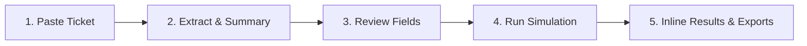

# SimuGuard AI — Operations & User Guide
**Pre-Deployment Security Change-Risk Assessment Platform**
*Apex Global Technologies Enterprise Security Operations*

---

## 1. Overview & System Purpose

SimuGuard AI is a local, pre-flight change-risk simulation and automated remediation engine. Designed specifically for **Network Security Operations Engineers** and **Identity Operations Engineers**, it allows security teams to model, analyze, and validate proposed infrastructure and access changes *before* deployment to production.

By evaluating proposed changes against an internal **Digital Twin** (220 active enterprise nodes and 77 directional relationships), SimuGuard AI calculates quantitative risk scores, determines blast radius, flags security policy violations, and synthesizes candidate least-privilege configurations.

The entire engineer workflow is centered around a unified **Single Assessment Workspace** that eliminates multi-page context switching.

---

## 2. Application Navigation

The streamlined sidebar provides four high-level sections:

| Navigation Item | Purpose | Key Capabilities |
| :--- | :--- | :--- |
| **⚡ New Assessment** *(Default Landing Page)* | The primary unified assessment workspace. Centers the entire change-risk workflow on one screen. | Paste change requests; extract configurations; review fields; execute simulation; inspect inline results, blast radius, remediation patches, and download reports. |
| **📋 Assessment History** | Complete historical ledger of change requests and audit activity logs. | Filter by domain, priority, status; search tickets; open historical changes directly into the primary workspace. |
| **📄 Reports** | Publication-grade compliance reports and compliance export hub. | View KPI metrics across all assessments; download executive audit PDFs and machine-readable JSON exports. |
| **⚙️ Settings & Diagnostics** | Administrative environment controls and platform health diagnostics. | Toggle between Demo Sandbox and Production; reset demo scenarios safely; inspect system health and runtime integrity. |

---

## 3. The Single Assessment Workspace Workflow

The assessment lifecycle follows five unified steps on one screen:



### Step 1: Paste Change Request
1. Locate the **1. Paste Change Request** intake card on the main screen.
2. In the 300px dark-navy text area, paste the raw ServiceNow change ticket, OR
3. Click one of the one-click template buttons:
   - **Official Project Firewall Change Requests**:
     - `📄 CHG-1001 (Outbound HTTPS)`: Scoped outbound HTTPS API connectivity (`ALLOW`).
     - `📄 CHG-1002 (Unrestricted Egress)`: Broad outbound any/any rule (`BLOCK_DEPLOYMENT`).
     - `📄 CHG-1003 (Internal DB Seg)`: Internal database segmentation rule (`ALLOW`).
     - `📄 CHG-1004 (Inbound NAT)`: Inbound NAT exposing portal (`BLOCK_DEPLOYMENT`).
     - `📄 CHG-1005 (Vendor Modify)`: Vendor access modification (`BLOCK_DEPLOYMENT`).
   - **Additional Scenarios**: Expand the scenario drawer to access `PR-4082` (DB Ingress), `PR-4083` (DMZ & IAM), `Netflix` (Streaming), `Safe Rule` (Telemetry), or `SailPoint` (S3 Access).

### Step 2: Extract Configuration & Plain-English Summary
1. Click the **🔍 Extract Configuration** button directly below the input text area.
2. Review the generated **Change Request Summary**:
   - **1. What is being requested?**: Clear plain-English summary of the firewall or IAM modification.
   - **2. Why is this change requested?**: Exact business justification extracted directly from the original ticket.
   - **3. Key configuration changes**: Native Streamlit table detailing target firewall, operation, zones, addresses, applications, services, and profile parameters.
   - **4. Initial observations & potential risks**: Highlights of high-risk flags (e.g. wildcard addresses, missing profiles, disabled logging, pending approvals).

### Step 3: Review Extracted Configuration
1. Directly below the summary, review the **2. Review Extracted Configuration** card.
2. For **Firewall Policies**:
   - Inspect rule name, target firewall (`PAN-NGFW-EDGE-01`, etc.), source zone, destination zone, CIDRs, application (`ssl`, `web-browsing`, `any`), service port, action (`allow`), security profile group, and logging.
   - In-place adjustments can be made if any parameter was omitted in the ticket.
3. For **Identity Governance (SailPoint ISC)**:
   - Inspect worker name, employee/worker ID (`EMP-...`, `CTR-...`), worker type, requested roles/entitlements, and approval status.
4. Validation alerts:
   - Red alerts highlight missing mandatory parameters.
   - Amber alerts highlight policy ambiguities (e.g. placeholder `TBD` addresses, `applications = any`).

### Step 4: Run Pre-Flight Assessment
1. Click the prominent **🚀 Run Pre-Flight Assessment** button.
2. The deterministic simulation engine models the change against the Digital Twin, evaluates CIS/NIST security benchmark rules, computes blast radius, and generates automated remediation patches.

### Step 5: Inline Results, Remediation & Verification
All assessment results render immediately on the same page below the intake section:

1. **Executive Decision Banner**:
   - `ALLOW` (Green): Low-risk change ($\text{Score} < 40$). Zero CRITICAL, zero HIGH, zero UNKNOWN impacts.
   - `WARN_MANUAL_REVIEW` (Amber): Elevated risk ($\text{Score } 40 - 69$), HIGH severity finding, or unmapped entity requiring CAB review.
   - `BLOCK_DEPLOYMENT` (Red): Prohibitive risk ($\text{Score } \ge 70$) or at least one CRITICAL security violation.
2. **KPI Score Cards**:
   - Baseline Risk Score ($0 - 100$).
   - Security Gaps Identified count.
   - Affected Infrastructure Assets count.
   - Candidate Risk Score (post-remediation).
   - Risk Reduction Delta (e.g. $-100$ pts).
3. **Structured Results Tabs**:
   - **🔍 Security Findings & Assets**:
     - *Security Gaps*: Complete breakdown of policy violations with Rule IDs (`FW-01`, `IAM-01`, `SP-01`), severity, compliance violations (PCI-DSS, CIS Benchmarks, NIST), and technical impact.
     - *Directly Affected Infrastructure Assets*: Table listing affected workloads, firewall appliances, and data stores with asset criticality, blast tier (`DIRECT` vs `CASCADING`), and data classification.
   - **🌐 Digital Twin Blast Radius**:
     - Interactive view of direct entrypoints and cascading transitive dependencies reached through satisfied traversal conditions.
     - Unmapped resources and unknown topology impacts.
   - **🛠️ Remediation & Candidate Patch**:
     - Actionable least-privilege remediation plan.
     - Synthesized candidate Terraform HCL patch code ready for deployment review.
     - Pre-implementation CLI validation commands (PAN-OS policy match tests, IAM checks).
   - **⚖️ Before & After Comparison**:
     - Differential score delta (e.g. $100 \rightarrow 0$ points).
     - Verdict transition (e.g. `BLOCK_DEPLOYMENT` $\rightarrow$ `ALLOW`).
     - Finding resolution status matrix (`RESOLVED`, `PARTIALLY_RESOLVED`, `MANUAL_REVIEW_REQUIRED`).
     - Confirmation of severed data exfiltration paths.
   - **📄 Export Compliance Report**:
     - **📥 Download Executive PDF Report**: Two-pass numbered audit report complete with executive summary, findings, blast radius inventory, and candidate diffs.
     - **📥 Download Structured JSON Artifact**: Audit-ready JSON export (schema version 1.0.0).

---

## 4. Assessment History Navigation

Navigate to **📋 Assessment History** from the sidebar:
- **Historical Change Ledger**: Review all past assessments stored in SQLite.
- **Search & Filters**: Filter by domain (`Network Security` vs `Identity Governance`), priority (`Critical`, `High`, `Medium`, `Low`), or workflow state.
- **Inspect Past Assessments**: Click **Open in Workspace** on any historical record to reload the change request and its full simulation context back into the Single Assessment Workspace.
- **Audit Activity Log**: View immutable timeline events (`ASSESSMENT_STARTED`, `ASSESSMENT_COMPLETED`, `REMEDIATION_GENERATED`).

---

## 5. Reports & Compliance Hub

Navigate to **📄 Reports** from the sidebar:
- **Compliance KPI Dashboard**: Aggregated statistics across all evaluated change requests (total assessments, approval rate, average risk score, total risk reduction).
- **Report Downloader**: Select any assessed change request from the dropdown to download:
  - Executive Audit PDF.
  - Machine-readable JSON compliance artifact.

---

## 6. Settings & Diagnostics

Navigate to **⚙️ Settings & Diagnostics** from the sidebar:
- **Environment Selector**:
  - **Demo Sandbox Mode** (Default): Connected to `simuguard_demo.db` with certified demonstration scenarios.
  - **Production Mode**: Connected to isolated `simuguard_history.db` for enterprise change records.
- **Demo Database Reset**:
  - Click **🔄 Reset Demo Scenarios** to safely restore `simuguard_demo.db` to its clean baseline state at any time.
- **Diagnostics & Health**:
  - Verify SQLite WAL journaling and table counts.
  - Inspect Digital Twin integrity (220 nodes, 77 edges).
  - Verify that the production database maintains **0 records** during demo operations.

---

## 7. Running the Six Realistic Enterprise Test Scenarios

The directory `SimuGuard_Realistic_Org_Change_Requests` provides six synthetic enterprise change tickets:

1. `01_FW_Approved_SaaS_Integration.txt` (`CHG0098421`): Evaluates scoped SaaS outbound traffic, unmapped source zone `DC-APP`, and pending Change Manager approval (`WARN_MANUAL_REVIEW`).
2. `02_FW_Overbroad_ThirdParty_Access.txt` (`CHG0098476`): Evaluates vendor `any`/`any` rule with disabled security profiles and logging (`BLOCK_DEPLOYMENT`, score $\ge 85$).
3. `03_FW_Production_Database_Rule_Incomplete.txt` (`CHG0098510`): Evaluates database migration with placeholder `TBD` addresses (`BLOCK_DEPLOYMENT`, `INCOMPLETE-01`).
4. `04_IAM_Joiner_Standard_Finance_Analyst.txt` (`RITM0047312`): Evaluates new joiner Priya Nair (`EMP-4102`). Rejects fallback to `Priya Patel` and flags in-flight access (`BLOCK_DEPLOYMENT`).
5. `05_IAM_Mover_Conflicting_And_Privileged_Access.txt` (`RITM0047398`): Evaluates internal mover Arjun Mehta (`EMP-2871`) requesting `SAP - Finance Administrator`. Flags privileged access (`SP-04`) and privilege creep (`SP-06`).
6. `06_IAM_Leaver_Contractor_Offboarding.txt` (`RITM0047455`): Evaluates contractor Vikram Rao (`CTR-0924`) offboarding. Rejects fallback to `Vikram Sharma` and generates orphan account verification.

To run automated testing across all scenarios:
```bash
pytest simuguard-demo/tests/e2e/test_realistic_org_change_requests.py -v
```
